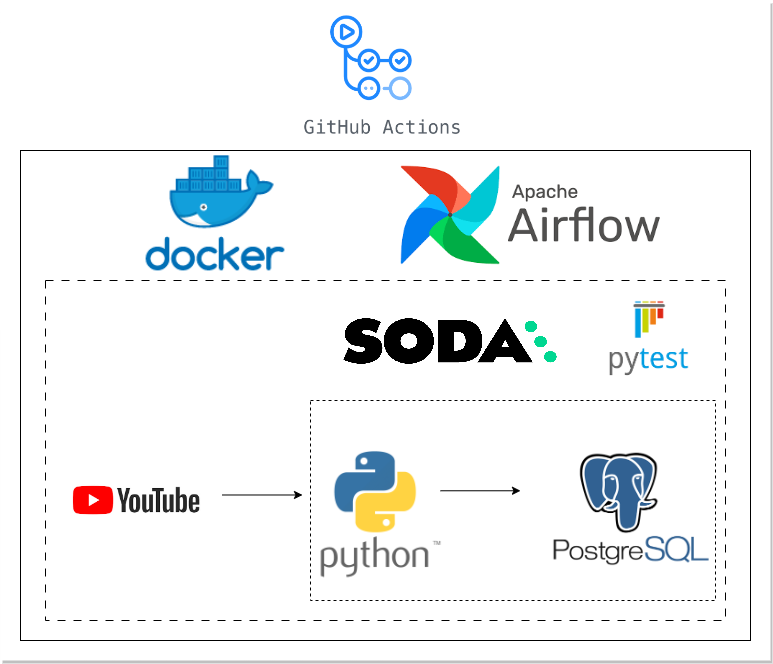

# youtube-dq-pipeline

Ежедневный пайплайн, который собирает статистику всех видео YouTube-канала, загружает её в PostgreSQL и проверяет качество данных. Оркестрация на Apache Airflow, весь стенд поднимается в Docker Compose, тесты запускаются в GitHub Actions.

По умолчанию собираются данные канала [@3blue1brown](https://www.youtube.com/@3blue1brown) — математика с анимацией. Любой другой канал подключается одной переменной в `.env`.

## Какие данные собираются

Для каждого видео канала:

| Поле | Описание |
|---|---|
| `Video_ID` | Идентификатор видео |
| `Video_Title` | Название |
| `Upload_Date` | Дата и время публикации |
| `Duration` | Длительность |
| `Video_Type` | `Shorts` (до 3 минут) или `Normal` |
| `Video_Views` | Число просмотров |
| `Likes_Count` | Число лайков |
| `Comments_Count` | Число комментариев |

Источник — [YouTube Data API v3](https://developers.google.com/youtube/v3/docs): методы `channels`, `playlistItems` и `videos`.

## Архитектура



Пайплайн состоит из трёх DAG, которые запускаются цепочкой:

1. **`produce_json`** — раз в сутки в 14:00 (Europe/Riga).
   - Получает плейлист загрузок канала.
   - Постранично собирает ID всех видео.
   - Пачками по 50 запрашивает их статистику.
   - Сохраняет результат в `data/YT_data_<дата>.json`, где дата — день запуска.
   - Запускает `update_db` и передаёт ему эту дату.
2. **`update_db`**.
   - Загружает JSON за переданную дату в таблицу `staging.yt_api`.
   - Переносит данные в `core.yt_api` с преобразованиями: длительность из формата ISO 8601 (`PT1M30S`) переводится в тип `TIME`, видео делятся на `Shorts` (до 3 минут, как разрешает YouTube с октября 2024 года) и `Normal`.
   - Каждая таблица обновляется одной транзакцией: `INSERT ... ON CONFLICT` по `Video_ID` добавляет новые видео и обновляет существующие, а видео, которых больше нет на канале, удаляются. Повторный запуск с теми же данными не создаёт дублей.
   - Пустая выгрузка считается сбоем источника: задача падает, таблицы не меняются.
   - Запускает `data_quality`.
3. **`data_quality`** — прогоняет проверки Soda сначала по `staging`, затем по `core`.

### Надёжность

- **Нет параллельных запусков.** У каждого DAG `max_active_runs=1`: повторный запуск ждёт в очереди, пока не закончится текущий.
- **Ретраи.** Задачи загрузки повторяются до 3 раз с растущей паузой (примерно 1, 2, 4 минуты). Проверки качества не повторяются: на тех же данных они дадут тот же результат.
- **Ограничение по времени.** Запуск DAG прерывается, если идёт дольше часа.
- **Перезапуск за прошлый день.** `update_db` можно перезапустить для любой даты, за которую есть файл в `data/`. Перезапуск `produce_json` за прошлую дату соберёт **текущую** статистику: YouTube API не отдаёт историю.

### Хранилище

Один контейнер PostgreSQL содержит три базы:

| База | Назначение |
|---|---|
| `elt_db` | Данные пайплайна: схемы `staging` и `core` |
| `airflow_metadata` | Метаданные Airflow |
| `celery_results` | Результаты задач Celery |

Базы и пользователи создаются при первом запуске скриптом `docker/postgres/init-multiple-databases.sh`.

### Проверки качества

Проверки описаны в `include/soda/checks.yml` и выполняются для обеих схем:

- `Video_ID` не пустой;
- `Video_ID` не повторяется;
- лайков не больше, чем просмотров;
- комментариев не больше, чем просмотров.

## Стек

Python 3.10, Apache Airflow 2.9.2 (CeleryExecutor, Redis), PostgreSQL 13, Soda Core, pytest, Docker Compose, GitHub Actions.

## Структура репозитория

```
youtube-dq-pipeline/
├── dags/
│   ├── main.py                  # три DAG и связи между ними
│   ├── api/video_stats.py       # клиент YouTube Data API
│   ├── datawarehouse/           # загрузка и преобразование данных
│   └── dataquality/soda.py      # запуск проверок Soda
├── include/soda/                # подключение к базе и проверки
├── docker/postgres/             # создание баз при старте Postgres
├── tests/                       # юнит- и интеграционные тесты
├── data/                        # JSON-выгрузки (создаются при работе)
├── .github/workflows/           # CI
├── docker-compose.yaml
├── dockerfile
└── .env.example                 # шаблон настроек
```

## Запуск

### Что понадобится

- Docker Desktop, выделено не меньше 4 ГБ памяти.
- Ключ YouTube Data API v3. Бесплатно:
  1. В [Google Cloud Console](https://console.cloud.google.com/) создайте проект.
  2. В разделе **APIs & Services → Library** включите **YouTube Data API v3**.
  3. В разделе **Credentials** нажмите **Create credentials → API key**.

  Бесплатной квоты (10 000 единиц в сутки) хватает с большим запасом: один полный сбор канала тратит несколько десятков единиц.

### 1. Настройки

```bash
cp .env.example .env
openssl rand -base64 32 | tr '+/' '-_'
```

В `.env` заполните:

- `FERNET_KEY` — строка, которую вывела вторая команда;
- `API_KEY` — ключ YouTube Data API;
- `CHANNEL_HANDLE` — хэндл канала без `@`, если нужен другой канал.

Остальные значения можно оставить по умолчанию. Имя базы `ELT_DATABASE_NAME` должно оставаться `elt_db`: оно используется в коде.

### 2. Сборка образа и запуск

```bash
docker build -t local/youtube-dq-airflow:latest .
docker compose up -d
```

Первый запуск занимает несколько минут. Проверить состояние:

```bash
docker compose ps
```

Стенд готов, когда `airflow-webserver`, `airflow-scheduler` и `airflow-worker` в статусе `healthy`.

### 3. Запуск пайплайна

Откройте http://localhost:8080. Логин и пароль задаются в `.env`, по умолчанию `airflow` / `airflow`.

Новые DAG создаются на паузе. Снимите с паузы **все три**: цепочка запускает следующий DAG, но на паузе он не выполнится. Затем запустите `produce_json` кнопкой ▶.

То же самое из терминала:

```bash
docker exec airflow-scheduler airflow dags unpause produce_json
docker exec airflow-scheduler airflow dags unpause update_db
docker exec airflow-scheduler airflow dags unpause data_quality
docker exec airflow-scheduler airflow dags trigger produce_json
```

Дальше пайплайн запускается сам каждый день.

### 4. Просмотр данных

Подключиться к базе изнутри контейнера:

```bash
docker compose exec postgres psql -U yt_api_user -d elt_db
```

Или любым клиентом с Mac: `localhost:5433`, база `elt_db`, пользователь и пароль из `.env`.

Примеры запросов:

```sql
-- самые просматриваемые видео
SELECT "Video_Title", "Video_Views", "Video_Type"
FROM core.yt_api
ORDER BY "Video_Views" DESC
LIMIT 10;

-- сколько Shorts и обычных видео
SELECT "Video_Type", COUNT(*), SUM("Video_Views") AS views
FROM core.yt_api
GROUP BY "Video_Type";
```

### 5. Тесты

```bash
docker exec -it airflow-worker pytest tests/ -v
```

- **Юнит-тесты** проверяют, что все DAG загружаются без ошибок и содержат ожидаемые задачи.
- **Интеграционные тесты** обращаются к YouTube API и к базе, поэтому нужен заполненный `.env`.

### Остановка

```bash
docker compose down        # остановить стенд
docker compose down -v     # остановить и удалить все данные в базе
```

## CI

Workflow `.github/workflows/ci-cd_yt.yaml` запускается при push в `main` и `feature/*`, при pull request и вручную:

1. При изменении `dockerfile` или `requirements.txt` собирает образ и публикует его в Docker Hub.
2. Поднимает стенд через Docker Compose, запускает pytest и прогоняет все три DAG командой `airflow dags test`.

Настройки передаются через **Secrets** и **Variables** репозитория. Используются те же имена, что и в `.env.example`, плюс `DOCKERHUB_USERNAME` и `DOCKERHUB_PASSWORD`.
